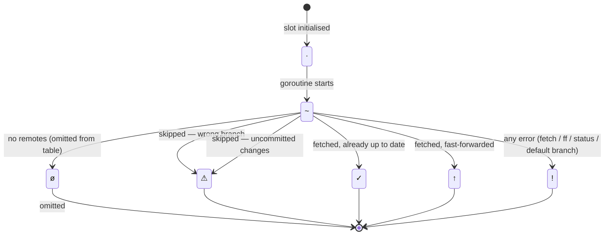

# `wtg repo sync` — progress symbols and state diagram

## Progress bar symbols

Run `wtg repo sync --progress` to watch each repo's slot in real time.
Each slot cycles through these symbols:

| Symbol | Meaning |
|--------|---------|
| `·`    | Waiting to start |
| `~`    | Fetch in flight |
| `ø`    | Silently omitted — no remote configured |
| `✓`    | Done — already up to date |
| `↑`    | Done — fast-forwarded to origin |
| `⚠`    | Skipped — wrong branch or uncommitted changes (purely local check, flips fast) |
| `!`    | Error — fetch, fast-forward, or status call failed |

The bar also shows a `(N fetching)` suffix after the closing `]` with the
count of in-flight network calls, so it is always clear whether sync is
still working or just waiting on the last few stragglers.

`⚠` slots flip noticeably faster than the others because the branch and
dirty checks are local and run before any network call.

## State transition diagram



The diagram renders natively on GitHub. To export a PNG locally:

```sh
npx --yes @mermaid-js/mermaid-cli mmdc \
  -i docs/repo-sync.md \
  -o docs/repo-sync.png \
  --outputFormat png
```

## Where the transitions live in the code

The state machine is not an explicit struct — it is encoded in the
[`RunSync`](../internal/cmd/repo.go) goroutine and the
[`syncOne`](../internal/cmd/repo.go) helper:

| Transition  | Location |
|-------------|----------|
| `· → ~`     | goroutine start, before calling `syncOne`; `inFlight` counter incremented |
| `~ → ø`     | `syncOne` returns `("", "")` — repo has no remotes; `inFlight` decremented |
| `~ → ⚠`     | `syncOne`: branch check or dirty check; `inFlight` decremented |
| `~ → ✓`     | `syncOne`: fetch succeeded, `Behind == 0`; `inFlight` decremented |
| `~ → ↑`     | `syncOne`: fetch succeeded, fast-forward succeeded; `inFlight` decremented |
| `~ → !`     | `syncOne`: any `error` return from runner calls; `inFlight` decremented |
